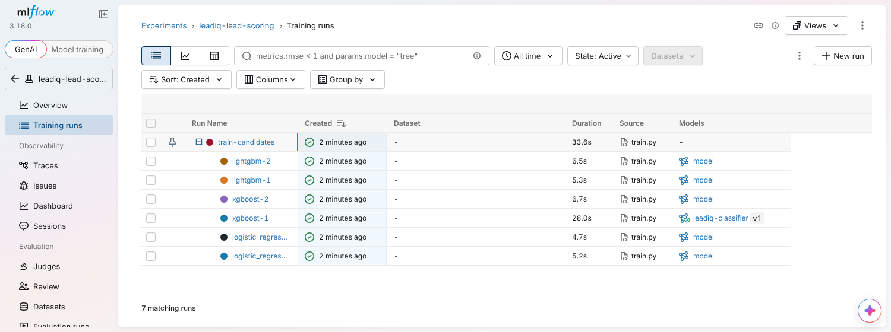
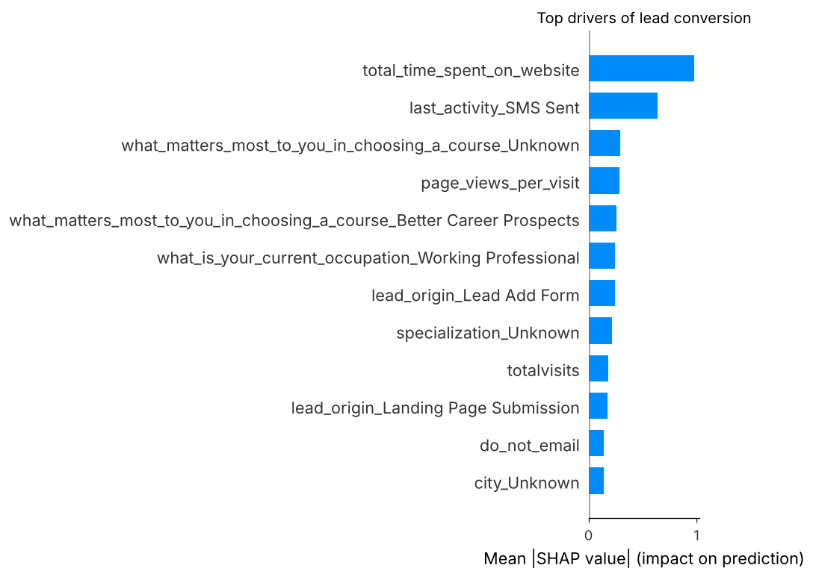

# LeadIQ: Explainable Lead Scoring with an End-to-End MLOps Pipeline

LeadIQ predicts which sales leads are likely to convert and sorts them into **Hot / Warm / Cold** bands, explains each score with SHAP, and suggests a follow-up action, so a sales team can focus on the leads that matter.

**Dataset:** [X Education Lead Scoring (Kaggle)](https://www.kaggle.com/datasets/amritachatterjee09/lead-scoring-dataset): 9,240 leads, 37 columns, target `Converted` (38.5% converted).

```
          training loop                                     serving loop
 leads.csv ─► validate ─► preprocess ─► train ─► evaluate ─► register ─► export ─► Docker ─► ECS (API + dashboard)
   (DVC)     (Pandera)                 (MLflow)            (registry)                          │
     ▲                                                                                        ▼
     └──────── Prefect retrain flow ◄── rep feedback + Evidently drift ◄──── Prometheus / Grafana / CloudWatch
```

## Results

| Model (best of each family) | CV ROC-AUC | CV F1 |
| --- | --- | --- |
| **XGBoost** (depth 3, 200 trees), selected | **0.908** | **0.782** |
| LightGBM (15 leaves, 200 trees) | 0.905 | 0.774 |
| Logistic Regression (C = 1.0) | 0.898 | 0.761 |

On the held-out test set (1,848 leads) the selected model scores **ROC-AUC 0.890, F1 0.766**. Leads it marks **Hot** converted **82%** of the time, versus **60%** for Warm and **13%** for Cold.

## Training pipeline (`dvc repro`)

| Stage | Script | What it does | Outputs |
| --- | --- | --- | --- |
| validate | `src/validate.py` | Pandera schema checks (types, allowed values, unique IDs, no negative counts). Stops the pipeline if the data is bad. | `reports/validation.json` |
| preprocess | `src/preprocess.py` | Treats the form default "Select" as missing, drops IDs, **leakage columns filled in by sales after contact** (`Tags`, `Lead Quality`, ...) and mostly-empty columns, caps outliers, imputes, groups rare categories, stratified 80/20 split. | `data/processed/train.csv`, `test.csv` |
| train | `src/train.py` | Adds rep-labelled leads from `data/feedback/feedback.csv`, trains 6 candidates (Logistic Regression, XGBoost, LightGBM × 2 settings) with 5-fold CV. Each is a nested MLflow run with params, metrics, confusion matrix and model. | `models/model.joblib`, `reports/train.json` |
| evaluate | `src/evaluate.py` | Test-set metrics, Hot/Warm/Cold conversion rates, ROC curve and SHAP importance, logged to MLflow. | `metrics/test_metrics.json`, `reports/plots/` |
| register | `src/register.py` | Registers `leadiq-classifier` with tags (model type, metrics, data hashes, git commit) and sets an alias (see below). | `reports/registry.json` |
| export | `src/export_model.py` | Copies the `champion` (and `canary`) model from the registry into the folder the API image is built from. | `models/serving/` |

All settings live in `params.yaml`; changing one and running `dvc repro` reruns only the affected stages.

**Model registry aliases**

| Alias | Meaning |
| --- | --- |
| `champion` | Serves normal traffic. The first model gets it automatically. |
| `canary` | A new version that beat the champion's test ROC-AUC. Gets a small share of live traffic (`CANARY_WEIGHT`, default 10%). |
| `challenger` | A new version that was not better. Kept for the record, never served. |

`python src/promote.py` makes the canary the champion once it has scored at least `canary.min_requests` live leads and is not doing worse than the champion on rep feedback. `--rollback` drops it instead.

## Serving

- **API** (`app/`, FastAPI): `POST /predict` returns probability, band, the top 3 SHAP reasons and a follow-up suggestion. Hot leads get a next action and an email opener from an LLM (Claude) when `ANTHROPIC_API_KEY` is set; otherwise a template is used. `POST /feedback` stores the rep's converted / lost outcome. `GET /metrics` exposes Prometheus metrics. Docs at `/docs`.
- **Dashboard** (`dashboard/app.py`, Streamlit): score a lead and record the outcome, plus lead pipeline quality over time (leads per band per day, average probability, real conversion rate by band, recent leads).

## Monitoring and retraining

- **Prometheus + Grafana** (`monitoring/`): request rate, p95 latency, error rate, leads by band, champion vs canary traffic, feedback rate. Alert rules: API down, error rate > 5%, p95 latency > 1 s, more than 80% Cold leads.
- **Evidently** (`src/drift.py`): compares live leads (and predicted probabilities) with the training data and writes `reports/drift/`.
- **Prefect** (`flows/retrain_flow.py`): pulls rep feedback from the API, runs the drift report, and if there are at least 50 new labelled leads or drift was found, versions the feedback with DVC and runs `dvc repro`. Scheduled weekly with `--serve`.
- **CloudWatch**: container logs and a CPU alarm on AWS.

## How to run

Requires Python 3.12 and Docker.

```bash
python -m venv .venv && .venv\Scripts\activate          # Linux/Mac: source .venv/bin/activate
pip install -r requirements.txt
dvc pull            # or download "Lead Scoring.csv" from Kaggle to data/raw/leads.csv
dvc repro           # full training pipeline
pytest -q           # unit tests
mlflow ui --backend-store-uri sqlite:///mlflow.db       # http://127.0.0.1:5000
```

Whole app on one machine:

```bash
docker compose up --build
# API http://localhost:8000/docs   Dashboard http://localhost:8501
# Prometheus http://localhost:9090  Grafana http://localhost:3000 (admin / admin)
python src/simulate_traffic.py --n 200       # send test leads (+ feedback) for a demo
python src/drift.py                          # drift report
python flows/retrain_flow.py                 # retraining flow, once
python src/promote.py                        # finish a canary rollout
```

Each machine keeps its own MLflow store (`mlflow.db`). After `dvc pull`, run `dvc repro -f` once to fill your local MLflow.

## Deploying to AWS

Terraform in `infra/terraform` creates the S3 bucket (DVC remote), two ECR repositories, an ECS Fargate cluster and service (API and dashboard in one task), CloudWatch logs and alarm, and an OIDC role for GitHub Actions. It uses the default VPC with public IPs, with no load balancer or NAT gateway, to keep costs low.

```bash
cd infra/terraform
terraform init && terraform apply              # service starts stopped (desired_count = 0)
dvc remote add -d storage <dvc_remote output> && dvc push
```

Then in GitHub: add secret `AWS_DEPLOY_ROLE_ARN` (the `github_deploy_role_arn` output) and repository variable `DEPLOY_ENABLED=true`.

1. **Start the app:** run `terraform apply -var desired_count=1`.
2. **Deploy:** every push to `main` that passes CI runs `.github/workflows/cd.yml`. It pulls `models/serving` from S3, builds and pushes both images, and rolls out ECS.
3. **Stop it:** run `terraform apply -var desired_count=0` (or `terraform destroy`) when you're done, so Fargate stops charging.

## Screenshots

MLflow runs (6 candidates; the best is linked to the registered model):



Model registry (`leadiq-classifier`, version tags and aliases):


Top drivers of conversion (SHAP):



## Repository layout

```
├── src/                 # pipeline stages, drift report, canary promotion, traffic simulator
├── app/                 # FastAPI scoring API
├── dashboard/           # Streamlit dashboard
├── flows/               # Prefect retraining flow
├── docker/              # Dockerfiles; docker-compose.yml at the root
├── monitoring/          # Prometheus config + alerts, Grafana dashboard
├── infra/terraform/     # AWS infrastructure
├── tests/               # pytest (cleaning logic + API)
├── .github/workflows/   # CI (tests, image build, terraform checks) and CD (deploy)
├── dvc.yaml, dvc.lock, params.yaml
└── data/                # raw / processed / feedback data (DVC-tracked)
```
