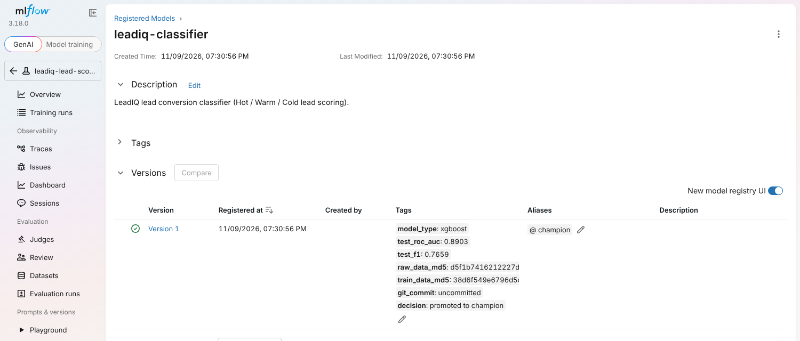

# LeadIQ: Explainable Lead Scoring with an End-to-End MLOps Pipeline

LeadIQ predicts which sales leads are likely to convert and sorts them into **Hot / Warm / Cold** bands, so a sales team can focus on the leads that matter. This repository is **Phase 1**: data versioning, a reproducible training pipeline, experiment tracking and a model registry.

**Dataset:** [X Education Lead Scoring (Kaggle)](https://www.kaggle.com/datasets/amritachatterjee09/lead-scoring-dataset): 9,240 leads, 37 columns, target `Converted` (38.5% converted).

## Phase 1 results

| Model (best of each family) | CV ROC-AUC | CV F1 |
| --- | --- | --- |
| **XGBoost** (depth 3, 200 trees), selected | **0.908** | **0.782** |
| LightGBM (15 leaves, 200 trees) | 0.905 | 0.774 |
| Logistic Regression (C = 1.0) | 0.898 | 0.761 |

On the held-out test set (1,848 leads) the selected model scores **ROC-AUC 0.890, F1 0.766**. Leads it marks **Hot** converted **82%** of the time, versus **60%** for Warm and **13%** for Cold.

## Pipeline

```
data/raw/leads.csv.dvc → validate → preprocess → train → evaluate → register
```

| Stage | Script | What it does | Outputs |
| --- | --- | --- | --- |
| validate | `src/validate.py` | Pandera schema checks (types, allowed values, unique IDs, no negative counts). Stops the pipeline if the data is bad. | `reports/validation.json` |
| preprocess | `src/preprocess.py` | Treats the form default "Select" as missing, drops IDs, **leakage columns filled in by sales after contact** (`Tags`, `Lead Quality`, ...) and mostly-empty columns, caps outliers, imputes, groups rare categories, stratified 80/20 split. | `data/processed/train.csv`, `test.csv` (DVC-versioned) |
| train | `src/train.py` | Trains 6 candidates (Logistic Regression, XGBoost, LightGBM × 2 settings each) with 5-fold CV. Each is a nested MLflow run logging params, metrics, a confusion matrix and the model. Picks the best by CV ROC-AUC. | `models/model.joblib` (DVC-versioned), `reports/train.json` |
| evaluate | `src/evaluate.py` | Test-set metrics, Hot/Warm/Cold conversion rates, ROC curve and SHAP feature importance, logged to MLflow. | `metrics/test_metrics.json`, `reports/plots/` |
| register | `src/register.py` | Registers the model as `leadiq-classifier` in the MLflow Model Registry with tags (model type, metrics, data MD5 hashes, git commit). Moves the `champion` alias only if the new version beats the current champion; otherwise tags it `challenger`. | `reports/registry.json` |

All settings (split size, thresholds, hyperparameters) live in `params.yaml`, so changing a value and running `dvc repro` reruns only the affected stages.

## How to run

Requires Python 3.11+.

```bash
git clone <this-repo-url> && cd leadiq
python -m venv .venv && source .venv/bin/activate   # Windows: .venv\Scripts\activate
pip install -r requirements.txt

# Get the data: either pull from the DVC remote (team members with access) ...
dvc pull
# ... or download "Lead Scoring.csv" from Kaggle and save it as data/raw/leads.csv

dvc repro              # runs the whole pipeline
dvc metrics show       # test metrics
mlflow ui --backend-store-uri sqlite:///mlflow.db   # open http://127.0.0.1:5000
pytest -q              # unit tests
```

Each machine keeps its own MLflow store (`mlflow.db`). If you pulled the model with `dvc pull` and `dvc repro` skips training, run `dvc repro -f` once to fill your local MLflow.

Try an experiment: change a value in `params.yaml` (e.g. `max_depth`) and run `dvc repro` again. A new MLflow run and a new registry version appear.

## Data versioning (DVC)

- `data/raw/leads.csv` is tracked by `data/raw/leads.csv.dvc`; only this small pointer file is in Git.
- Processed data and the model file are DVC pipeline outputs, with hashes recorded in `dvc.lock`.
- Remote storage (AWS S3):

```bash
dvc remote add -d storage s3://<your-bucket>/leadiq-dvc
dvc push
```

## Evidence

MLflow runs (6 candidates; the best is linked to the registered model):


Model registry (`leadiq-classifier`, version tags and `champion` alias):



Top drivers of conversion (SHAP):


## Repository layout

```
├── data/raw/leads.csv.dvc   # DVC pointer to the raw dataset
├── src/                     # pipeline stages + shared helpers
├── tests/                   # pytest unit tests
├── docs/                    # screenshots for this README
├── dvc.yaml, dvc.lock       # pipeline definition and locked hashes
├── params.yaml              # all pipeline settings
├── .github/workflows/ci.yml # runs tests on every push
└── requirements.txt
```

## Roadmap

Phase 2+: FastAPI scoring service and Streamlit dashboard, Docker, deployment on AWS (ECR + ECS) with Terraform, Prefect retraining, Evidently drift monitoring, Prometheus + Grafana.
